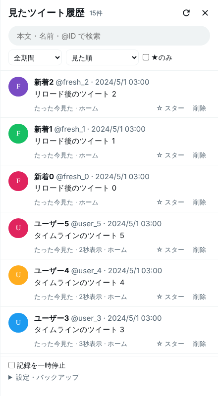
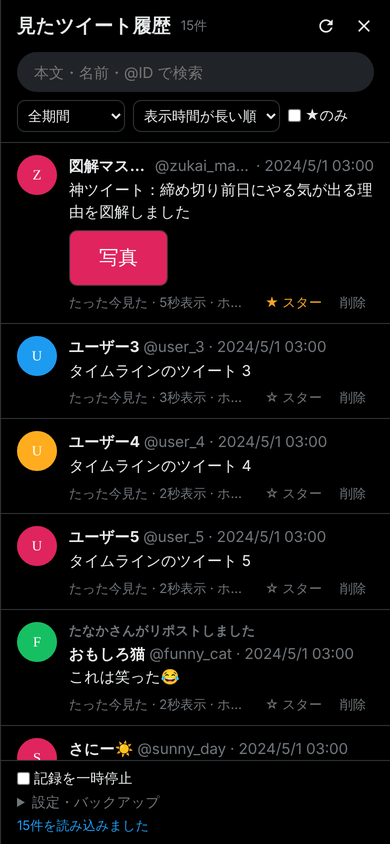

# Tweet Recovery - 見たツイート履歴

「めっちゃいいツイートを見つけたのに、タイムラインを更新して消えてしまった」を防ぐツールです。

X (Twitter) をブラウザで見ている間、**画面に表示されたツイートを自動でブラウザの中に記録**しておきます。
更新して見失っても、履歴パネルから「さっき見たツイート」をすぐに探し直せます。

| PC | スマホ (ダークテーマ) |
| --- | --- |
|  |  |

## できること

- **自動記録** — 画面に半分以上表示されたツイートを記録します。操作は何もいりません (広告は記録しません)
- **見た順** — 最後に見たものから順に並びます。更新直前に見ていたツイートが一番上の方に来ます
- **表示時間が長い順** — 画面に長く表示されていた順。「スクロールの手を止めて読んだあれ」を探すときに便利です
- **検索** — 本文・表示名・@ID・引用元の本文・「〇〇さんがリポスト」から探せます。スペース区切りで AND 検索。全角・半角は区別しません
- **期間で絞り込み** — 1時間以内 / 24時間以内 / 7日以内
- **★スター** — ★を付けたものは保存期間を過ぎても消えません
- **一時停止** — 記録したくないときは止められます
- **エクスポート / インポート** — JSON でバックアップ・別のブラウザへの移行ができます

記録はすべて**自分のブラウザの中 (x.com のサイトデータ)** に保存され、どこにも送信しません。

## 使い方

1. いつも通り X をスクロールするだけで記録されます
2. 見失ったら、画面左下の **青い時計ボタン** を押すか **Alt+Shift+H** (Mac は Option+Shift+H) で履歴パネルを開きます
3. ツイートを押すと X の元のツイートが新しいタブで開きます

時計ボタンはドラッグで好きな位置に動かせます (位置は記憶されます)。パネルは Esc か ✕ で閉じます。

## インストール

X の**公式アプリには組み込めません**。このツールを使うときは、ブラウザで x.com を開いて見てください。

### Chrome / Edge / Brave (PC) — 拡張機能として

1. このリポジトリをダウンロード (Code → Download ZIP) して展開
2. `chrome://extensions` を開き、右上の「デベロッパー モード」をオン
3. 「パッケージ化されていない拡張機能を読み込む」で `tweet-recovery/extension` フォルダを選ぶ
4. x.com を開き直すと左下に時計ボタンが出ます

### Firefox / その他のブラウザ (PC) — ユーザースクリプトとして

1. [Tampermonkey](https://www.tampermonkey.net/) か [Violentmonkey](https://violentmonkey.github.io/) を入れる
2. 「新規スクリプトを作成」を開き、[`extension/tweet-recovery.user.js`](extension/tweet-recovery.user.js) の中身を全部貼り付けて保存
   (リポジトリが公開されていれば、GitHub でこのファイルの「Raw」を開くだけでインストール画面が出ます)

### iPhone / iPad (Safari)

1. App Store から無料の **Userscripts** アプリを入れる
2. 設定 →（アプリ →）Safari → 機能拡張 → Userscripts をオンにし、x.com での実行を許可
3. Userscripts アプリで指定したフォルダに `tweet-recovery.user.js` を保存する
   (または Safari のアドレスバーの拡張メニュー → Userscripts → 新規作成 に中身を貼り付ける)
4. **Safari で** x.com を開いて使う

### Android

1. **Firefox for Android** を入れ、アドオンから Tampermonkey か Violentmonkey を追加
2. 上の「ユーザースクリプトとして」と同じ手順でスクリプトを追加
3. **Firefox で** x.com を開いて使う

拡張機能とユーザースクリプトを両方入れても、二重には動きません。

## 注意点

- **x.com のサイトデータ (Cookie など) を消すと履歴も消えます。** 大事なものは★を付けたうえで、ときどき「設定・バックアップ → エクスポート」で保存してください
- 履歴はブラウザごとに別々です (PC とスマホで自動同期はしません。エクスポートしたファイルをインポートすれば移せます)
- 「さらに表示」で省略されている長文は、画面に出ていた部分だけ記録されます (末尾に「…」)。ツイートを開けば全文が見られ、開いたときに全文で記録し直されます
- 一瞬で通り過ぎたツイート (画面の半分以上に出なかったもの) は記録されません
- 保存期間は初期設定で 30 日です。「設定・バックアップ」で 7日〜無期限 に変えられます
- X の画面の作りが変わると記録されなくなることがあります。その場合は `tweet-recovery.user.js` の先頭近くにある `SEL` (読み取りに使っている目印) を直してください

## 開発

```
tweet-recovery/
├── extension/
│   ├── manifest.json           # Chrome 拡張機能 (Manifest V3)
│   ├── tweet-recovery.user.js  # 本体。ユーザースクリプトと拡張機能で同じファイルを使う
│   └── icons/
├── test/
│   ├── fixture.cjs             # X のタイムラインを真似たテスト用ページ
│   └── e2e.cjs                 # Chromium で実際に動かして確かめるテスト
└── docs/                       # README の画像
```

テストは Playwright で x.com を模したページを開き、記録・検索・スター・エクスポート・一時停止・拡張機能としての読み込みなどを確認します。

```sh
cd tweet-recovery
npm install
npx playwright install chromium   # 初回のみ
npm test
```
